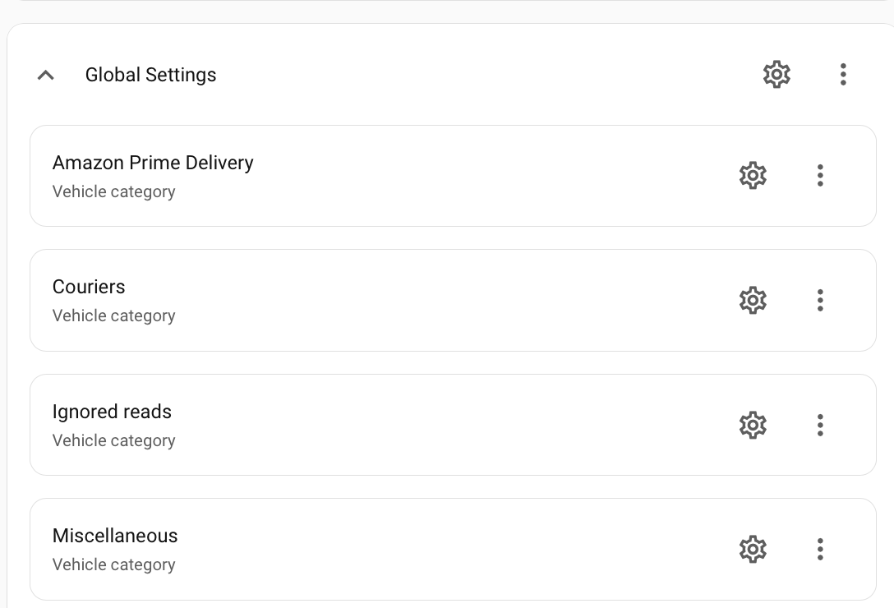
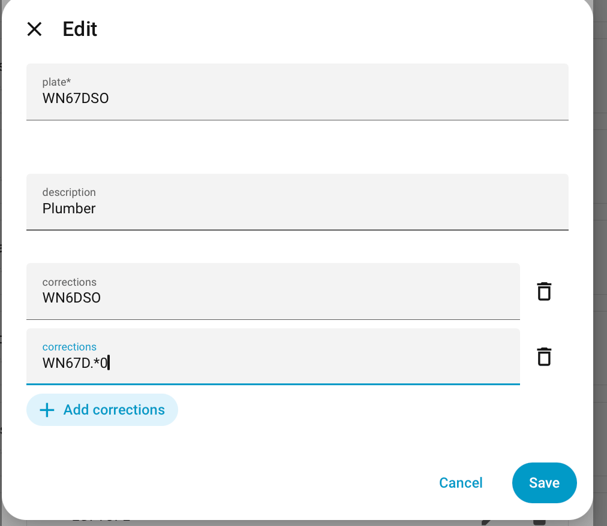

# Vehicles

> The functionality here is designed for home use, to customize notifications based on which vehicle is entering a domestic property. Read the [Privacy and Legal Concerns](#privacy-and-legal-concerns) before using.

## Deriving a Licence Plate

Auto Notify has several ways to source a licence plate for a vehicle picked up by cameras:

- Listen for Frigate's own plate recognition (ANPR/ALPR) on MQTT
- Subscribe to an [anpr2mqtt] topic on MQTT
- Listen for `found_plate` events from a Home Assistant [Image Processing](./image_processing.md) integration, like OpenALPR, scanning any camera, a Frigate one included

## Enriching the Plate
Once it has a plate, then it has several ways to enrich it:

- In the UK, look up the DVLA API to get the manufacturer, model, registration date, colour, tax status etc
- Track the sightings by time of day and classify the vehicle as a daily/weekly/occasional visitor and when it is usually seen, including earliest/latest times of day
- Match the plate to a known vehicle, or category of vehicles, such as your own car, postal delivery, or suspicious vehicles listed by local Neighbourhood Watch
- Automatically make corrections for plates that ANPR/ALPR commonly gets wrong
- Ignore licence plates, or patterns (regular expressions) of plates
- Assign a priority to notifications based on the vehicle classification

{width=500}

## How it Works

Every licence plate read, by Frigate's plate recognition (ANPR/ALPR), an image processing integration such as OpenALPR, or [anpr2mqtt], is classified here, its visit history kept unless *Track visits* is off, and in the UK, looked up with the DVLA:

- **Vehicle categories**, added under *Global Settings*: a single vehicle, every family car, or a delivery company's vans, known or dangerous, by their plates, each a plate or a regular expression, with its own description and the misreads that are really it. *Ignore* drops a category's plates altogether, such as a tanker's logo read as a plate
- **Priority**: in the *Vehicles* section of *Global Settings*, once there's a category, each with its own Supernotify scenarios: `medium` for a known vehicle, `high` for an unknown plate or one that couldn't be read, and `critical` for a dangerous one. A misread plate can match a dangerous one, so `critical` can be a false alarm; corrections on the plate, or a lower priority, help where it happens
- **Descriptions**: the vehicle's description and plate, such as *Joe's mini (TJ912UKL)*, the DVLA's make, colour, year and tax, its previous sightings, whether it's a daily, weekly or occasional visitor, and whether it's at an unusual time of day
- **DVLA (UK)**: with an API key from the UK DVLA's Vehicle Enquiry Service, in *Vehicle lookup*, kept as a credential and never shown again. A plate a character off the last one confirmed on the same camera is taken as a misread of it
- **Known vehicle**: a button on a notification of an unknown plate, with a description typed on the phone, adding it to the category set in *Category for the Known vehicle button*, *Known vehicles* to begin with
- **OpenALPR, or another ANPR/ALPR image processing integration**: a source of its own, each plate it reads classified as any other. See [Image Processing](./image_processing.md)
- **Actions**:
  - `camera_autonotify.classify_plate`, for any other plate source or automation, returning the plate's category, lookup and history
  - `camera_autonotify.add_plate`
  - `camera_autonotify.remove_plate`
  - `camera_autonotify.list_vehicle_categories`, with each category's plates
  - `camera_autonotify.reset_sightings`, forgetting a plate's sightings, or every plate's
- **Import from anpr2mqtt**: upload a tarball of anpr2mqtt's `config` and `data` folders, such as made by `tar czf anpr2mqtt.tgz config data/plate`, in *Global Settings* or as an anpr2mqtt source is set up, to bring over its targets, corrections, ignores, DVLA settings and visit history. What's found is shown before anything is imported, and what was added after
- **Event**: with *Fire vehicle events* on, in *Vehicles*, `camera_autonotify_vehicle` for each sighting, with `plate`, `entity_id` and `confidence` as OpenALPR's `image_processing.found_plate` has them, and the category, classification, lookup and history

{width=500}

### Number Plates from anpr2mqtt

[anpr2mqtt] does three things:

1. **Plates from ANPR/ALPR cameras**: it listens for the images an ANPR/ALPR camera uploads by FTP, or to a NAS, and reads the plate from each, with optional OCR to read some of the camera's own analysis, like direction or speed.
2. **Frigate's plates, enhanced**: it can listen for Frigate plate messages, and enrich them. Not needed when using Camera AutoNotify
3. **Any other detection** a camera can make that results in an image sent by FTP or to a NAS, such as a face, or a line crossed

- **What you need**: anpr2mqtt 1.3.0 or later, with its Home Assistant devices on (`device_creation`, as it comes). Each anpr2mqtt camera is then found and offered as *Discovered*, even with *Set up cameras automatically* on, so its setup can import from anpr2mqtt. Frigate isn't needed
- **What's sent**: details of the vehicle as a JSON payload on an MQTT topic, and the image itself as a binary payload on a different topic. See [Home Assistant Integration](https://anpr2mqtt.rhizomatics.org.uk/homeassistant/) for the details. This can also include an area for the camera to show up as for Home Assistant, and the identity of the linked camera.
- **Health**: anpr2mqtt going unavailable is notified, and again when it's back, with the timing of the Frigate health checks

#### Avoiding Duplicate Notifications

The same car arriving can be notified twice: by the Frigate camera's review, *Car detected at Driveway*, updated with the plate where Frigate knows it, and by anpr2mqtt's sighting, *Joe's Pickup at Driveway*, with the DVLA's details. anpr2mqtt itself, and Frigate's plate recognition (ANPR/ALPR), carry on as they are, since it's only the notification that's to be switched off.

anpr2mqtt reading the same plate from both Frigate and an ANPR/ALPR camera's images is already notified once, as the same plate in the same visit. So it's the Frigate camera's notification of the car to switch off, in the Frigate camera's settings here, by either:

- leaving `car` out of *Objects*, choosing the others you still want notified, so the camera notifies people and the rest but not cars, which anpr2mqtt notifies instead
- or switching off *Notify recognised faces and plates*, in *Timing*, to keep the camera's car notification, but not its update when Frigate recognises the plate. This stops the update for a recognised face too

## Privacy and Legal Concerns

Licence plates may be treated as personal data in your location, and it is your responsibility to know your obligations before collecting and using any data.

Each plate's visit history, and its cached DVLA details, are kept by a hash of the plate salted with a secret of your installation's own, never the plate itself, and `reset_sightings` forgets a plate's history, or all of it. *Fire vehicle events* is off to begin with, since Home Assistant's recorder keeps each event, plate included.

This may mean that not all the features offered here are available for your use, especially if this plugin, intended for personal home use, is applied in a commercial environment.

### References

- [UK ICO Guidelines for Organisations on ANPR](https://ico.org.uk/for-organisations/uk-gdpr-guidance-and-resources/cctv-and-video-surveillance/guidance-on-video-surveillance-including-cctv/additional-considerations-for-technologies-other-than-cctv/automatic-number-plate-recognition-anpr/?search=Taxi)

[anpr2mqtt](https://anpr2mqtt.rhizomatics.org.uk)
